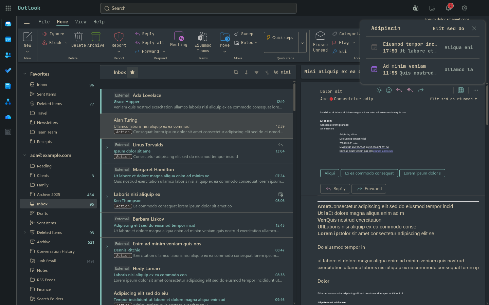

# Omaoutlook

Microsoft Outlook for [Omarchy](https://omarchy.org): the real Outlook web
client in its own window, re-skinned live with your Omarchy theme, and
behaving like the Outlook app — not like a browser tab.

- **Every sign-in works.** Password, Authenticator push and number matching,
  SMS and call, FIDO2 security keys, certificate-based sign-in, federated
  identity providers (ADFS, Okta, Ping, Google), personal Outlook.com
  accounts and work or school accounts.
- **Links go where they belong.** A link in a message opens in your default
  browser. A popped-out message, a new mail or a calendar item opens in an
  Outlook window of its own. `mailto:` links start a new message, Teams
  meeting links open in [Omateams](https://github.com/Divanyx/omateams) when
  it is installed, and the sign-in stays inside the app.
- **Mail-client things a tab can't do.** Unread badge in the bar, new-mail
  and reminder notifications that open the message, attachments saved to
  `~/Downloads` with *Open* / *Show in folder*, printing through your PDF
  viewer, and an optional system-wide `mailto:` handler.
- **Built to run for weeks.** A watchdog keeps a long-running page from
  eating your RAM (see *Memory* below).



## How it works

Outlook on the web is built on Fluent UI, which paints its surfaces from CSS
custom properties. Omaoutlook injects one stylesheet that redefines them
from the handful of colors an Omarchy theme ships, so nothing in Outlook
has to be matched by selector, and tells Outlook whether the theme is light
or dark so message bodies follow too.

Two parts:

- **The host** (`omaoutlook`) — a small Qt/QML program that hosts Outlook in
  a QtWebEngine view with a persistent profile, injects the theme, routes
  every link and window Outlook opens, forwards notifications to
  `notify-send`, handles sign-in popups, security keys, client certificates,
  downloads and printing, and writes a status file. It runs as its own
  process on purpose: a Chromium renderer fault must never take the desktop
  shell down with it, and Quickshell cannot initialise the WebEngine anyway.
- **The Omarchy plugin** (`manifest.json` + `ui/`) — a bar widget with the
  unread count, a service that watches the host's status file, starts the
  host hidden with the shell, and hands the plugin settings over.

## Install

```bash
omarchy plugin add https://github.com/Divanyx/omaoutlook.git --enable
```

That is all. When the shell loads the plugin, it builds the Outlook window
(a small Qt program, a few seconds with `qmake6`) and installs it to
`~/.local/share/omaoutlook/bin/omaoutlook`, with a symlink in `~/.local/bin`,
desktop entries and an icon. A notification says when it is ready; then
click the Outlook icon in the bar (or run `omaoutlook`) and sign in.

The build needs `qt6-webengine`, `qt6-declarative`, `libnotify`, `jq` and
`base-devel`; a stock Omarchy has all but `qt6-webengine`. The plugin
installs no system packages itself: if one is missing, a notification names
it, a click on the Outlook icon opens Omarchy's package installer, and setup
continues on its own once the package is there.

The window opens tiled like any other; a Hyprland rule can float or pin it
(`class: omaoutlook`). Optional keybinding in `~/.config/hypr/bindings.lua`:

```lua
o.bind("SUPER + SHIFT + O", "Outlook", "omaoutlook toggle")
o.bind("SUPER + SHIFT + M", "New mail", "omaoutlook compose")
```

`omarchy plugin update omaoutlook` is enough to update: on the next shell
start the plugin notices the new sources (or a Qt upgrade) and rebuilds the
window. An Outlook window running hidden in the background is restarted on
the new build right away; an open one picks it up when it is next started.
`~/.config/omarchy/plugins/omaoutlook/install.sh` rebuilds by hand.

Remove with `~/.config/omarchy/plugins/omaoutlook/uninstall.sh` (`--purge`
also deletes the signed-in profile) and `omarchy plugin remove omaoutlook`.

## Bar widget

| Click  | Action                           |
|--------|----------------------------------|
| left   | show / hide the Outlook window   |
| right  | show and focus it                |
| middle | write a new message              |

The icon is the Outlook glyph from the Nerd Font the bar already uses; it
dims while Outlook is not running, an accent dot marks unread mail and the
count sits next to it. The launcher icon is a pixel-grid take on the Outlook
mark, recolored from the active theme at install time.

Settings live on the widget's entry in `~/.config/omarchy/shell.json`
(Setup › Plugins in the shell, or `omarchy bar set`):

| Key               | Default                                 | Meaning |
|-------------------|-----------------------------------------|---------|
| `showBarIcon`     | `true`                                  | Hide the icon and drive Outlook from a keybinding instead |
| `showCount`       | `true`                                  | Unread count next to the icon |
| `runInBackground` | `true`                                  | Start the window hidden with the shell, so badge, notifications and reminders work before you open it |
| `notifications`   | `On`                                    | Forward Outlook notifications to the Omarchy notification daemon |
| `mailtoHandler`   | `false`                                 | Make Omaoutlook the desktop's `mailto:` handler |
| `teamsLinks`      | `Omateams`                              | Teams meeting links: Omateams (when installed) or the browser |
| `downloadDir`     | *(empty: `~/Downloads`)*                | Where attachments are saved |
| `followTheme`     | `true`                                  | Re-skin Outlook with the Omarchy theme |
| `useShellFont`    | `true`                                  | Render Outlook in the shell's monospace family |
| `zoom`            | `100`                                   | Zoom in percent |
| `closeAction`     | `Hide window`                           | What the window's close button does; `Quit` ends the process |
| `memoryLimit`     | `1536`                                  | MB the page may reach before it is reloaded in the background; `0` never |
| `url`             | `https://outlook.cloud.microsoft/mail/` | Outlook endpoint; `https://outlook.live.com/mail/` for Outlook.com |

## Where links go

| What                                                          | Opens in |
|---------------------------------------------------------------|----------|
| A link in a message (Safe Links included), SharePoint, OneDrive, the app launcher | default browser |
| *Open in new window*, a double-clicked message, a calendar item | an Outlook popout window |
| `mailto:` (in a message, or from any app with `mailtoHandler`) | a new-message window |
| *Join Teams meeting*                                           | Omateams, or the browser |
| Microsoft or identity-provider sign-in, MFA setup              | the in-app sign-in dialog |
| An Outlook add-in's dialog                                     | an in-app dialog, so it can talk back to the add-in |
| `tel:`, `ms-word:` and other schemes                           | whatever handles them on your desktop |

## CLI

```
omaoutlook                 open (or focus) the window, starting Outlook if needed
omaoutlook --hidden        make sure Outlook runs, without showing the window
omaoutlook toggle          show / hide
omaoutlook show | hide
omaoutlook compose         new message
omaoutlook open <link>     mailto: starts a message, an Outlook link opens in the window,
                           anything else goes to the browser
omaoutlook reload          start Outlook over in a fresh page (frees what it piled up)
omaoutlook status          JSON: running, signedIn, unread, visible, popouts, memory (MiB)
omaoutlook reload-theme    re-read colors.toml and Hyprland's rounding
omaoutlook quit
```

Outlook claims most Ctrl shortcuts (Ctrl+R reply, Ctrl+Q mark as read,
Ctrl+N new message), so the window keeps out of their way: `Ctrl+W` hides
(closes a popout), `F5` reloads, `Ctrl+=` / `Ctrl+-` / `Ctrl+0` zoom,
`Ctrl+Shift+F5` re-applies the theme. Quit from the CLI or the launcher's
*Quit Outlook* action.

## Memory

A web mail client left open for weeks is the classic RAM eater. Omaoutlook
deals with it on several levels:

- **Memory-reducing collection in the background.** V8 keeps the heap a
  page grew to long after the objects in it are gone, and Chromium does not
  give it back from a page that runs hidden. A minute after the window goes
  out of sight, and every ten minutes after that, omaoutlook runs V8's
  memory-reducing garbage collection on the page: a settled Outlook drops
  from ~900 MB to ~520 MB. Nobody sees the few hundred milliseconds it takes.
- **No idle overhead.** Chromium's spare renderer process and back/forward
  cache are off, and one process per site makes popouts and sign-in dialogs
  share the main renderer instead of starting their own. Popouts and dialogs
  are destroyed, not hidden, when closed. The disk cache is capped at 256 MB.
- **A watchdog for the page.** Every five minutes it reads the size of the
  page (`omaoutlook status` shows `memory` for the page and `memoryTotal`
  for the whole process tree); ten minutes after a load it notes what the
  settled page takes. Once the page passes the larger of `memoryLimit` and
  one and a half times that, it is started over in a fresh process — but
  only while the window has been out of sight for ten minutes, no popout is
  open, no download is running and no message is being written, and at
  most once an hour. A plain reload would keep the process and its memory;
  this discards the page and frees it completely. The badge is back within
  a minute.
- `omaoutlook reload` does the same on demand; `memoryLimit: 0` turns it
  off; `runInBackground: false` starts Outlook only on demand.

## Notes and limitations

- **Sign-in and cookies.** The session lives in a normal Chromium profile
  under `~/.local/share/omaoutlook/`, like any browser or Omarchy web app.
- **Passkeys and security keys.** A USB security key works: omaoutlook shows
  the PIN, the account list and the "touch your key" prompt in a themed
  dialog. A passkey kept by the device itself, by a phone over the QR code,
  or inside another browser's password manager does not: Chromium on Linux
  has no built-in authenticator and QtWebEngine carries no UI for the
  phone-and-QR route. Such a sign-in gives up after the site's own timeout
  and leaves the page free to offer another way in.
- **Certificates** come from the NSS database in `~/.pki/nssdb` (import a
  `.p12` with `pk12util -i cert.p12 -d sql:$HOME/.pki/nssdb`).
- **Seamless SSO** works with a Kerberos ticket (`kinit`) for tenants that
  offer it; without one the normal sign-in appears.
- **Notifications** need Outlook's own switch once: Settings › General ›
  Notifications › Desktop notifications.
- **What theming can't reach.** Message bodies keep their sender's design
  (Outlook's own dark mode adapts them), and images and a few brand accents
  stay as they are.
- Omaoutlook is not affiliated with Microsoft. Microsoft Outlook is a
  trademark of Microsoft Corporation.

## Development

```bash
# host, loading QML from disk instead of the compiled resources
mkdir -p ~/.cache/omaoutlook/build && cd ~/.cache/omaoutlook/build
qmake6 OMAOUTLOOK_VERSION=dev ~/Projects/omaoutlook/host/omaoutlook.pro && make
OMAOUTLOOK_QML_DIR=~/Projects/omaoutlook/host/qml ./omaoutlook --debug-port 9334

# then inspect the live page at http://127.0.0.1:9334/json (Chrome DevTools protocol)
# OMAOUTLOOK_DEBUG=1 logs where every link and window goes (journalctl --user);
# OMAOUTLOOK_DRY_RUN=1 also keeps them from leaving the app
node tests/theme.test.js
node tests/links.test.js
omarchy plugin validate .
```

## License

MIT — see [LICENSE](LICENSE).
